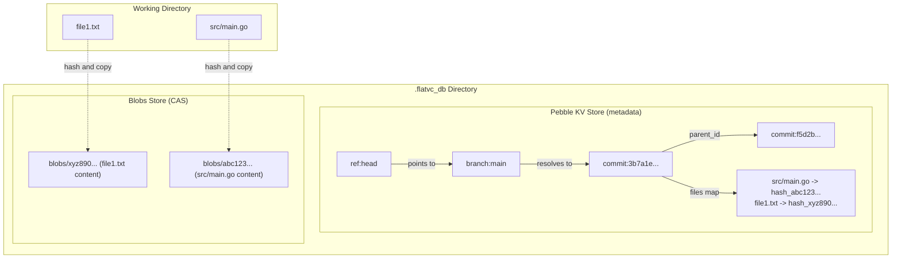

# flatvc: Key-Value Version Control System in Go

`flatvc` is a simplified, human-friendly CLI version control system implemented in Go. Instead of using a hierarchical Merkle Tree structure (like Git), it utilizes **Pebble** (a pure-Go LSM key-value store compatible with RocksDB) for tracking repository metadata and a flat filesystem blob store for content-addressable storage.

---

## Design Architecture

### Flat Snapshot Design
Unlike Git, which uses `tree` objects representing nested folders to calculate parent directory hashes, `flatvc` uses a **Flat File Map**. A commit in `flatvc` contains a flat `map[string]string` that maps every tracked file's relative path directly to its SHA-256 blob hash.
* **Pros:** Highly simple to implement and inspect; eliminates complexity of tree serialization/deserialization.
* **Cons:** Comparing two commits requires iterating over the path maps, which is $O(N)$ (where $N$ is the total number of tracked files) instead of $O(D)$ (where $D$ is the number of modified directories in a Merkle tree).

### Storage Architecture Diagram


---

## Key-Value Database Schema (Pebble)

| Namespace Prefix | Key Format | Value Type | Description |
| :--- | :--- | :--- | :--- |
| `ref:` | `ref:head` | `[]byte` | Current branch reference (`branch:name`) or direct commit ID (detached). |
| `branch:` | `branch:<name>` | `[]byte` | Commit ID pointed to by the branch. |
| `tag:` | `tag:<name>` | `[]byte` | Immutable commit ID pointed to by the tag. |
| `commit:` | `commit:<commit_id>` | `JSON (Commit)` | Commit metadata: Parent ID, Message, Author, AuthorEmail, Timestamp, Signature, and Files map. |
| `index` | `index` | `JSON (map[string]string)` | Current staging area (`path -> blob_hash`). |

---

## Command Reference

* `flatvc init`: Creates the `.flatvc_db` folder structure and sets up the Pebble database.
* `flatvc add <files...>`: Generates hashes, writes content to `.flatvc_db/blobs/`, and stages changes in Pebble's `index`.
* `flatvc commit -m <message>`: Creates a commit from the staged files, records it in history, and moves the head branch pointer. Optionally signs the commit if `user.gpg_key` is set.
* `flatvc status`: Displays current active branch, staged files, unstaged changes, and untracked files.
* `flatvc diff`: Compares line-by-line changes using the system `diff -u` command for text, source, xml, json files, or displays a binary difference log for assets.
* `flatvc log`: Lists full commit history starting from head, displaying author details, emails, and GPG signature status.
* `flatvc checkout <branch|tag|commit>`: Restores working directory files to the snapshot at target version.
* `flatvc branch <name>`: Creates a new branch reference at current head.
* `flatvc tag <name>`: Creates a new tag reference at current head.
* `flatvc filter-branch --remove-file <file>`: Rewrites history to delete a file from all commits and updates references.
* `flatvc clone <remote_path> <local_path>`: Clones a remote repository to local.
* `flatvc fetch`: Syncs missing commits and blobs from a remote.
* `flatvc push [--ours]`: Pushes local changes to the remote. Ancestry verification ensures fast-forward unless `--ours` is used to force-push.
* `flatvc pull [--theirs]`: Pulls and merges remote changes. Discards local modifications and matches remote HEAD if `--theirs` is used.
* `flatvc reword <commit_id> <message>`: Rewrites a specific previous commit's message, rebuilding descendant commits dynamically.
* `flatvc verify <commit_id>`: Verifies the GPG signature on a commit.
* `flatvc config [key] [value]`: Set/get repository config values (e.g. `user.name`, `user.email`, `user.gpg_key`).
* `flatvc watch [--interval 60s]`: Automatically stages and snapshots changes periodically with empty commit messages.
* `flatvc serve [--port 8080]`: Starts a REST API server.

---

## REST API Specification

Starts an HTTP server on the specified port containing the following routes:

* `GET /status` - Returns repository status as JSON.
* `GET /log` - Returns the history log as JSON.
* `POST /add` - Accepts file path list to stage.
  - Body format: `{"files": ["path1", "path2"]}`
* `POST /commit` - Performs a commit with a message.
  - Body format: `{"message": "commit message", "author": "author name"}`
* `GET /cat/<hash>` - Returns raw content of the specified blob.

---

## Development Guide

### Compiling and Running Tests
Since Pebble has a Go-native interface, we compile with Cgo disabled to ensure hassle-free cross-compiling on Windows:
```powershell
# Run all unit tests
$env:CGO_ENABLED=0
go test -v ./...

# Build executable
go build -o flatvc.exe
```

---

## License

`flatvc` is licensed under the **PolyForm Noncommercial License 1.0.0**.

* Full text: [`LICENSE`](LICENSE)
* Canonical URL: <https://polyformproject.org/licenses/noncommercial/1.0.0>

This is a **source-available, noncommercial** license — it is *not* an
open-source license. In short:

* **Permitted:** any noncommercial purpose, including personal use for
  research, experiment, testing, study, hobby projects and amateur
  pursuits, as well as use by charitable, educational, public research,
  public safety/health, environmental, or government organizations.
* **Also permitted:** changing the software and distributing copies, as
  long as you comply with the license terms and pass along the notice below.
* **Not permitted:** any commercial use, and sublicensing or transferring
  the license to others.

Required Notice:

> Required Notice: Copyright Xyzzy Apps (xyzzyapps@gmail.com)

Any distribution of the software or works based on it must include these
terms (or their URL) together with the Required Notice line above.
